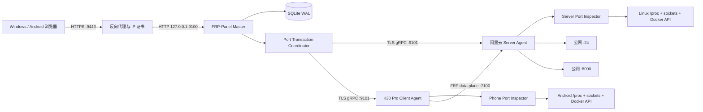

# FRP 端口穿透管理平台设计规格

> 定位：本文件是 FRP-Panel 端口管理扩展的唯一设计基准。实施计划、测试和验收均以此为准。

- 状态：已审批，独立评审修订版
- 日期：2026-08-02
- 上游项目：[`VaalaCat/frp-panel`](https://github.com/VaalaCat/frp-panel)
- 上游基线：`main@1a58b85`
- FRP 内核基线：`github.com/fatedier/frp v0.65.0`
- 首期节点：阿里云 `47.109.18.109` + K30 Pro（LineageOS 23.2 / Android 16 / Magisk 30.7）

## 1. 目标与非目标

### 1.1 目标

第一版解决以下问题：

1. 在一个 Web/PWA 管理台中管理阿里云和 K30 Pro 的 FRP TCP/UDP 规则。
2. 保存规则前同时验证：
   - 阿里云公网端口可绑定且未被其他进程、FRP 规则或并发事务占用；
   - K30 Pro 本地目标端口正在监听；
   - Server、Client Agent 均在线且能返回可核查证据。
3. 查看两端正在监听、已建立连接、被 FRP 保留的端口，并关联 PID、进程和 Docker 容器。
4. 所有变更有审计、加密配置快照、自动补偿和一键回滚。
5. 迁移现有规则时保留旧 frps/frpc，出现异常可在 60 秒内恢复。
6. 第一版只管理当前两台节点，但数据模型和 RPC 不写死节点数量。

### 1.2 明确不做

1. 不修改 Linux 防火墙、firewalld、iptables 或阿里云安全组。
2. 不提供任意 Shell 执行接口。
3. 不启用 FRP-Panel 的 WireGuard、Worker、远程终端和多租户计费功能。
4. 不在本期升级 FRP 内核到 v0.70.1；先保持与现网 v0.65.0 一致，降低迁移变量。
5. 不支持从安全管理界面新建 HTTP/HTTPS/STCP/XTCP 规则。第一版仅支持 TCP/UDP；已有其他类型规则只读展示，不允许绕过安全校验修改。
6. 不把手机 Agent 放进 Docker。Agent 运行在 Magisk/root 宿主层，才能看到 Android 宿主机和 host 网络容器端口。

## 2. 已审批决策

| 决策项 | 结果 |
|---|---|
| 产品形态 | 响应式 Web App；满足可信 HTTPS 后支持 PWA 安装 |
| 第一版节点 | 阿里云 + K30 Pro，架构保留多节点扩展 |
| 技术路线 | FRP-Panel 开源底座 + Port Inspector（端口探测器）扩展 |
| UI | 信息密集型运维控制台 |
| 保存门禁 | 公网端口异常或本地端口异常均禁止保存 |
| 防火墙边界 | 只管理 FRP，不修改任何防火墙或安全组 |
| 访问方式 | 公网 IP + 独立 HTTPS 端口 + 单管理员登录 |
| 迁移方式 | 允许 30–60 秒切流；必须自动备份并支持一键回滚 |

## 3. 当前系统与源码证据

### 3.1 现网

| 项目 | 当前状态 |
|---|---|
| 主 frps | 阿里云 `:7000`，承载其他业务，本项目不迁移、不修改 |
| 手机专用 frps | 阿里云 `:7002`，当前映射公网 `24` 和 `8000` |
| K30 Pro SSH | 手机 `127.0.0.1:24`，公网 `47.109.18.109:24` |
| Scrapling MCP | 手机 host 网络 `0.0.0.0:8000`，公网 `/mcp`；已启用 Bearer Token |
| 手机 Docker | `iptables=false`、`ip6tables=false`；需要宿主端口的容器使用 `--network host` |
| 阿里云资源 | 2C / 约 1.7GB RAM；扫描时约 745MB 可用并有 3GB Swap |

### 3.2 上游源码缺口

| 证据 | 现状 | 本项目处理 |
|---|---|---|
| `biz/master/proxy/create_proxy_config.go` | 先改 Client 配置；Agent 更新异步执行，失败只记录警告 | 改为同步事务编排，失败自动补偿 |
| `biz/master/proxy/update_proxy_config.go` | 数据库更新发生在 Agent 成功确认前 | 候选配置先下发，验证通过后提交数据库 |
| `biz/master/client/update_tunnel.go` | `go func()` 异步调用 Agent，API 提前返回成功 | 安全变更路径必须等待 ACK |
| `services/rpc/client.go` | `CallClient` 无超时，可能永久阻塞并泄漏 Session Map | 新增超时、取消和 `defer` 清理 |
| `common/response.go` | `UpdateFRPSResponse/RemoveFRPSResponse` 错映射为 FRPC Event | 先写回归测试，再修正 Server ACK 事件 |
| `cmd/frpp/shared/providers.go` | Client/Server 始终调用 `TLSClientCertNoValidate`，未真正使用配置开关 | 接入严格证书校验，生产禁止跳过验证 |
| `conf/helper.go` | 证书只写入 localhost IP SAN；公网 IP 被放入 DNSNames | 识别 IP 并写入 IP SAN |
| `cmd/frpp/shared/providers.go` | 配置打印和 AutoJoin 日志可能输出 Secret | 统一脱敏配置和注册日志 |
| `utils/port.go` | 只有 `GetFreePort` | 新增监听、连接、绑定探测和归属识别 |
| `utils/process.go` | 只有子进程名称检查 | 新增 PID、可执行文件、服务、容器关联 |
| `models/db.go` | 无端口保留、事务、审计、快照表 | 新增四类模型并 AutoMigrate |
| `www/pages/proxies.tsx` | 无双端预检和端口证据 | 新增安全创建/编辑流程 |
| `www/config/nav.ts` | 无端口中心和审计入口 | 新增导航，隐藏本期不启用模块 |

## 4. 总体架构



### 4.1 控制面端口

候选端口已在阿里云实测：`9000/9001` 已占用，以下端口空闲。

| 用途 | 端口 | 暴露范围 |
|---|---:|---|
| Master Web/API | 9100 | 仅 `127.0.0.1` |
| Master TLS gRPC | 9101 | 公网，仅 Agent 使用 |
| 新 FRP 试运行 bindPort | 7100 | 公网，仅迁移后的 Client 使用 |
| Web HTTPS | 9443 | 公网，管理员访问 |
| 影子验证 | 20000–20010 | 临时公网测试 |

主 frps `:7000` 和现有手机专用 frps `:7002` 在切流前保持不变。

### 4.2 复用现有 Agent 通道

不新增第二套守护进程。Server/Client 已通过 `rpc_master.proto` 的双向流注册到 Master，Port Inspector 作为现有二进制中的新能力：

- 新增 `EVENT_INSPECT_PORTS`；
- 新增 `EVENT_VALIDATE_PORT`；
- 复用 `EVENT_UPDATE_FRPC`、`EVENT_UPDATE_FRPS` 下发候选配置；
- Master 必须等待 Agent Response，不再用 goroutine 提前返回成功；
- RPC 默认 TLS，生产环境设置 `CLIENT_TLS_INSECURE_SKIP_VERIFY=false`。

## 5. 端口状态与探测规则

### 5.1 状态定义

| 状态 | 定义 |
|---|---|
| `AVAILABLE` | OS 无冲突监听、FRP 无保留、无待处理事务，绑定探测成功 |
| `LISTENING` | TCP 为 LISTEN；UDP 为 UNCONN/已绑定 |
| `ACTIVE` | TCP ESTABLISHED 数大于 0，或 UDP 在采样周期内有流量证据 |
| `FRP_RESERVED` | 端口属于已提交 FRP 规则或待处理事务 |
| `OWNED_BY_CURRENT_RULE` | 编辑时端口由当前规则占用，可继续使用 |
| `CONFLICT` | 由其他进程、容器、FRP 规则或事务占用 |
| `UNKNOWN` | Agent 离线、权限不足、扫描超时、解析失败 |

`UNKNOWN` 不是“可能可用”。按审批结果，必须禁止保存。

### 5.2 证据字段

每条端口观测返回：

```text
node_id
protocol (tcp/udp)
ip_family (v4/v6)
local_address
local_port
socket_state
pid
process_name
executable
service_name
docker_container_id
docker_container_name
frp_proxy_name
active_connections
observed_at
source (/proc, gopsutil, docker, frp)
```

浏览器不显示完整命令行中的密钥参数；日志和 API 对 `token`、`secret`、`password` 字段统一脱敏。

### 5.3 探测实现

1. 首选 `gopsutil/v4/net.Connections` 获取结构化 socket 数据。
2. Linux/Android 兼容回退读取 `/proc/net/{tcp,tcp6,udp,udp6}`，再按 socket inode 关联 `/proc/<pid>/fd`。
3. 通过 `/proc/<pid>/exe`、`comm` 和 cgroup 信息识别进程，不用 `ps | grep` 作为判定证据。
4. Docker 关联通过只读 Unix Socket API 获取容器 PID、名称和网络模式，不调用任意 Docker Shell 命令。
5. 公网端口预检除扫描外，还执行短暂 `net.Listen`/`net.ListenPacket` 绑定探测；探测后立即关闭。
6. IPv4/IPv6 通配监听按冲突处理；不得假设 `[::]` 与 `0.0.0.0` 一定可同时绑定。

### 5.4 本地端口门禁

本地目标必须满足：

```text
Agent 在线
AND 扫描成功
AND 目标 IP/端口/协议存在监听
AND 监听不是僵尸或退出中的容器
```

K30 Pro 特殊约束：

- Agent 由 Magisk `service.d` 以 root 启动；
- SELinux 保持 Enforcing；
- Docker 因 `iptables=false`，有宿主端口需求的容器必须使用 host 网络；
- Scrapling MCP 当前符合该约束，并已启用 Bearer Token；影子端口测试仍必须验证无 Token=401、有 Token=200。

### 5.5 公网端口门禁

公网 TCP/UDP 端口必须满足：

```text
Server Agent 在线
AND 扫描成功
AND OS 绑定探测成功
AND 不属于其他 FRP 规则
AND 不属于其他待处理事务
```

编辑规则时，原端口被当前规则占用返回 `OWNED_BY_CURRENT_RULE`，不判冲突。

## 6. 数据模型

### 6.1 `port_reservation`

用于阻止两个保存请求同时抢占同一公网端口。

| 字段 | 类型 | 说明 |
|---|---|---|
| `id` | uint | 主键 |
| `server_id` | string | Server 节点 |
| `protocol` | string | tcp/udp |
| `remote_port` | uint32 | 公网端口 |
| `owner_proxy_id` | uint/null | 已提交规则所有者 |
| `transaction_id` | string | 当前事务 |
| `status` | string | pending/committed/releasing |
| `expires_at` | datetime | pending 租约过期时间 |

唯一约束：`(server_id, protocol, remote_port)`。

预约生命周期：

1. `pending` 默认租约为 120 秒；`committed` 不使用过期时间。
2. `TryAcquire` 必须在同一数据库事务中先删除目标端口已过期的 `pending` 记录，再尝试插入新记录。
3. Master 启动时清理全部过期 `pending`，并把关联的非终态事务标记为 `failed`；能确认 Agent 已应用候选配置时，先执行补偿再释放预约。
4. 后台回收任务每 30 秒扫描一次过期预约。只删除 `pending`，不得删除 `committed`。
5. 清理、补偿和释放均写入审计事件，避免“锁消失但原因不明”。

### 6.2 `change_transaction`

| 字段 | 说明 |
|---|---|
| `transaction_id` | UUID，唯一 |
| `idempotency_key` | 用户请求幂等键，唯一 |
| `actor_user_id` | 操作者 |
| `operation` | create/update/delete/start/stop/rollback |
| `proxy_id` | 目标规则，可空 |
| `status` | pending/preflight/applying/verifying/committed/rolling_back/rolled_back/failed/rollback_failed |
| `request_redacted` | 脱敏请求 |
| `evidence_json` | 双端预检和验证证据 |
| `error_code` | 结构化错误码 |
| `error_message` | 人类可读错误 |
| `started_at/finished_at` | 生命周期 |

`proxy_id` 在创建事务尚未生成规则 ID 时可以为空；删除旧数据后执行回滚时也允许为空，此时以事务快照和规则自然键定位。

### 6.3 `config_snapshot`

一键回滚需要完整配置，但不能把 Token 明文复制到审计表。

| 字段 | 说明 |
|---|---|
| `transaction_id` | 关联事务 |
| `side` | before/after |
| `node_type/node_id` | client/server |
| `ciphertext` | AES-GCM 加密配置 |
| `nonce` | AES-GCM nonce |
| `sha256` | 明文配置校验和 |
| `created_at` | 创建时间 |

首选从 root-only secret file 读取密钥：`/opt/frp-panel/secrets/snapshot.key`，权限 `0600`，容器只读挂载；`SNAPSHOT_ENCRYPTION_KEY` 仅作为兼容输入，不写入数据库、源码、日志或浏览器。

密钥生命周期：

1. 首次部署生成 32 字节随机密钥；同一值保存到 Bitwarden Secrets Manager 的专用 Secret，仓库和迁移 manifest 只记录密钥指纹。
2. Master 启动时比较 secret file 指纹与数据库 `snapshot_key_fingerprint`。缺失或不匹配时进入只读阻塞模式：允许查看，不允许写规则或回滚。
3. 切流前必须实际演练“从 Bitwarden 恢复 secret file → 解密历史快照”。
4. 轮换采用双密钥窗口：旧密钥解密、用新密钥重新加密全部快照、校验后再更新指纹；失败时保留旧密钥和旧密文。
5. 密钥丢失会导致历史快照不可解密，因此 Bitwarden 恢复演练属于生产门禁，不是建议项。

### 6.4 `audit_event`

记录登录、预检、创建、更新、删除、启动、停止、回滚和迁移操作。只存脱敏摘要、证据引用和结果，不存密钥。

### 6.5 端口观测缓存

端口扫描结果不长期入库，只缓存 5 秒。保存时必须重新实时扫描，不能使用 UI 列表中的旧数据。

## 7. API 与 RPC 合约

### 7.1 HTTP API

保留现有路由，但所有写操作必须调用统一的安全事务服务，禁止从旧 Handler 绕过。

| 路由 | 用途 |
|---|---|
| `POST /api/v1/port/list` | 查询节点端口、进程、容器和连接 |
| `POST /api/v1/proxy/preflight` | 返回双端预检证据，不写配置 |
| `POST /api/v1/proxy/create_config` | 安全创建，后端再次预检 |
| `POST /api/v1/proxy/update_config` | 安全更新，后端再次预检 |
| `POST /api/v1/proxy/delete_config` | 快照、下发、验证释放、提交 |
| `POST /api/v1/proxy/start_proxy` | 启动前重新执行双端门禁 |
| `POST /api/v1/proxy/stop_proxy` | 停止并审计，不要求本地端口仍监听 |
| `POST /api/v1/audit/list` | 审计列表 |
| `POST /api/v1/audit/get` | 事务详情与证据 |
| `POST /api/v1/audit/rollback` | 一键回滚指定事务 |

`CreateProxyConfigRequest` 和 `UpdateProxyConfigRequest` 增加：

```text
idempotency_key
preflight_token (仅优化 UI；提交时仍重新验证)
```

### 7.2 RPC

新增 protobuf：

- `idl/types_port.proto`
- `idl/api_port.proto`

扩展 `idl/rpc_master.proto`：

```text
EVENT_INSPECT_PORTS
EVENT_VALIDATE_PORT
```

请求必须限定节点、协议、IP、端口和是否需要 Docker 关联，不允许携带 Shell 文本。

### 7.3 错误码

| 错误码 | 含义 |
|---|---|
| `PORT_REMOTE_IN_USE` | 公网端口被占用 |
| `PORT_LOCAL_NOT_LISTENING` | 本地目标未监听（警告级：允许创建/启动，界面提示） |
| `CONFIG_VALIDATION_FAILED` | TCP/UDP 配置解析或字段校验失败 |
| `PORT_SCAN_UNAVAILABLE` | 探测失败或权限不足 |
| `AGENT_OFFLINE` | Server/Client Agent 离线 |
| `RESERVATION_CONFLICT` | 被其他事务抢占 |
| `UNSUPPORTED_PROXY_TYPE` | 第一版不支持该代理类型写入 |
| `APPLY_TIMEOUT` | Agent 应用配置超时 |
| `VERIFY_FAILED` | 应用后健康验证失败 |
| `ROLLBACK_FAILED` | 自动补偿失败，需要人工介入 |

前端必须显示具体节点、协议、端口、占用者和观测时间，不能只显示“保存失败”。

## 8. 安全变更事务

### 8.1 创建/更新

1. 解析并校验 TCP/UDP 配置。
2. 创建 `change_transaction`，按幂等键去重。
3. 在数据库事务中申请 `port_reservation`；唯一约束处理应用内并发。
4. 生成并加密保存 before/after 快照。
5. Server Agent 实时扫描并执行绑定探测。
6. Client Agent 验证本地监听并返回进程/容器证据。
7. 生成完整候选 Client 配置。
8. 同步调用 Client Agent 应用候选配置，等待 ACK；超时即失败。
9. 等待 Server 上报目标 Proxy 运行状态，并确认公网 socket 已由目标 frps 监听。
10. 在数据库事务中持久化 ProxyConfig、Client 配置、保留记录和审计事件。
11. 标记事务 `committed`。

UI 的 preflight 只是预览。步骤 5、6 在提交时必须重做，避免 TOCTOU（检查与使用之间的竞态）。

### 8.2 自动补偿

步骤 8 之后任一步失败：

1. 向 Client Agent 下发 before 快照并等待 ACK；
2. 验证旧规则重新出现或新端口已释放；
3. 恢复数据库 before 状态；
4. 释放 pending reservation；
5. 记录 `rolled_back` 和证据。

补偿失败时标记 `rollback_failed`，禁止继续修改该规则，并在首页显示红色阻塞告警。

### 8.3 删除、启动与停止

- 删除：快照 → 下发无目标规则的候选配置 → 验证公网端口释放 → 数据库删除。
- 启动：等同创建门禁，必须重新检查双端。
- 停止：快照 → 下发 → 验证停止 → 提交；不要求本地服务仍监听。

### 8.4 RPC 超时

现有 `services/rpc/client.go::CallClient` 会无限等待。本项目新增带 Context 的调用：

- 端口扫描：5 秒；
- 配置应用：15 秒；
- 运行状态验证：30 秒；
- 超时、断线或取消时必须从 `ClientRecvMap` 删除 Session 并关闭通道。

重试策略：

- 只读端口扫描遇到瞬时网络错误时允许重试 1 次，随机退避 200–500ms，但总时限仍不超过 5 秒；
- 配置应用属于有副作用写操作，不自动盲重试。超时后先用同一事务 ID 查询 Agent 实际状态，再决定提交或补偿；
- 运行状态验证每 1 秒轮询一次，最长 30 秒；
- 所有重试沿用同一事务 ID 和幂等键，不能创建第二条事务。

## 9. 管理界面

采用已审批的运维控制台布局。

### 9.1 导航

```text
总览
穿透规则
端口中心
节点
实时日志
审计与回滚
系统设置
```

隐藏 Worker、WireGuard 和远程终端入口。

### 9.2 总览

显示：节点在线数、活跃隧道、监听端口数、冲突数、事务失败数和最近事件。

### 9.3 端口中心

支持按节点、TCP/UDP、状态、端口范围过滤。表格字段：端口、协议、监听地址、状态、PID、进程、容器、FRP 规则、活动连接数、观测时间。

### 9.4 新建/编辑流程

1. 选择 Server 和 Client；
2. 选择本地监听服务或手填地址/端口；
3. 填写公网端口；
4. 点击“检查端口”；
5. 显示双端证据；
6. 只有两端均绿色才可点击保存；
7. 保存时后端重新检查；
8. 显示事务阶段和最终结果。

## 10. 认证与传输安全

1. 管理入口为 `https://47.109.18.109:9443`，Master 9100 只绑定回环地址；反向代理负责浏览器侧可信 HTTPS。
2. 浏览器侧证书使用 Let’s Encrypt short-lived IP certificate。实施基线为 Certbot 5.7+：`--ip-address 47.109.18.109 --preferred-profile shortlived`，通过 `manual-auth-hook/manual-cleanup-hook` 把 HTTP-01 challenge 写入现有 Nginx webroot，实现无人工续期。systemd timer 每 12 小时检查，证书剩余时间小于 72 小时告警；续期成功后 reload Nginx。证书自动化通过独立签发、`renew --dry-run`、真实续期和告警测试前，不开放公网管理入口。
3. HTTPS 应急通路为服务器 SSH 本地转发：`ssh -L 19100:127.0.0.1:9100 -p 22 root@47.109.18.109`，浏览器访问 `http://127.0.0.1:19100`。该流量受 SSH 加密；不得回退到公网 HTTP。
4. Master 自签 CA 用于 Agent gRPC：`conf.GetCertTemplate` 必须识别 `MASTER_API_HOST` 是 IP 还是域名；公网 IP 写入 `IPAddresses` SAN，域名写入 `DNSNames`。
5. Agent RPC 使用服务端 TLS 证书校验 + 每节点 `ConnectSecret` 应用层认证，不宣称 mTLS。`NewClientCred/NewServerCred` 必须真正遵循 `CLIENT_TLS_INSECURE_SKIP_VERIFY`：生产固定为 `false`，仅测试环境可显式开启。公网 9101 的握手失败、Secret 校验失败和连接速率均纳入审计与限速。
6. 设置：
   - `APP_COOKIE_SECURE=true`
   - `APP_COOKIE_HTTP_ONLY=true`
   - `APP_ENABLE_REGISTER=true` 仅首次创建管理员，随后关闭
   - 随机高熵 `APP_GLOBAL_SECRET`
   - Client/Server `CLIENT_API_URL=https://47.109.18.109:9443`
   - `CLIENT_RPC_URL=grpc://47.109.18.109:9101`
7. 登录接口限速、失败锁定、会话过期和 CSRF 防护纳入验收。
8. 增加仅能在服务器本地执行的 `frp-panel admin reset-password --password-stdin`；重置成功后使现有会话失效并写审计。不得提供未认证 HTTP 密码重置接口。
9. `Config.PrintStr`、AutoJoin、UpdateFRPC/UpdateFRPS 请求日志统一脱敏，不得输出 GlobalSecret、ClientSecret、FRP Token 或配置快照明文。
10. WebSocket `CheckOrigin` 从无条件 `true` 改为管理入口 Origin 白名单；本期禁用远程终端和 Worker。
11. Scrapling MCP Bearer Token 不进入 FRP-Panel 源码、数据库审计或界面；迁移只操作端口规则。

## 11. 资源与运行约束

### 11.1 阿里云

- Master + Server 试运行阶段设置内存上限并观察真实峰值；初始告警阈值 300MB，不在测量前宣称固定容量。
- SQLite 使用 WAL；数据、快照和日志放 `/opt/frp-panel/data`。
- 日志轮转，避免 13GB 剩余磁盘被流式日志占满。
- 影子运行 24 小时期间记录 RSS、Swap、CPU、数据库大小和 RPC 重连次数。

### 11.2 K30 Pro

- 使用上游 `build.sh --platform android --bintype client --arch arm64` 构建 `GOOS=android / GOARCH=arm64 / CGO_ENABLED=0` 的 Client，不拿 Linux 二进制硬跑 Android。
- Android ARM64 Client 先做兼容性门禁：启动、RPC TLS、socket 扫描、Docker 识别、Magisk 自启、SELinux Enforcing。
- 若 Android 目标无法读取宿主 socket/进程或不能稳定运行，不修改现网；回退到“官方 Android frpc + 独立只读探测 Agent”方案并重新评审。
- Agent 不修改 Docker daemon 的 `iptables=false` 配置。

## 12. 迁移与回滚

### 12.1 备份范围

阿里云：

```text
/opt/frp/frp_0.65.0_linux_amd64/frps-phone.toml
/etc/systemd/system/frps-phone.service
现有 frps-phone 二进制与 SHA-256
/opt/frp-panel/data/data.db（使用 SQLite 在线备份 API，或停止 Master 后复制）
/opt/frp-panel/data/data.db-wal、data.db-shm（仅在一致性备份方式需要时）
FRP-Panel 部署配置、镜像摘要与 snapshot key 指纹（不把密钥明文写入 manifest）
```

K30 Pro：

```text
/data/frp/frpc
/data/frp/frpc.toml
/data/adb/service.d/frpc.sh
文件权限、属主与 SHA-256
```

备份必须写入带时间戳目录，生成 manifest；恢复脚本使用绝对路径并在执行后验证服务。

### 12.2 阶段

1. 兼容性门禁：不碰现网。
2. 并行部署：Master 9100/9101、新 Server 7100、新 Client 与旧 frpc 同时运行。旧手机 `/data/adb/service.d/frpc.sh` 和旧 frpc 进程在整个 7 天观察期持续重连 `:7002`，不得提前停止或删除。
3. 影子验证：
   - `20000 → K30 Pro:24`
   - `20001 → K30 Pro:8000`
   - 验证 SSH、MCP 401/200、断网重连和 24 小时资源指标。
4. 切流：停止 `frps-phone:7002`，新系统接管公网 24/8000，目标停机 30–60 秒。
5. 观察：旧配置和脚本至少保留 7 天；云端和手机各重启一次。

主 frps `:7000` 全程不修改。

### 12.3 一键回滚

1. 停止新 24/8000 规则并确认端口释放；
2. 恢复阿里云 manifest 对应文件和权限；
3. `systemctl daemon-reload && systemctl start frps-phone`；先等待 `systemctl is-active frps-phone`，再确认控制端口 `:7002` 已监听，超时 15 秒即报告失败；
4. 依赖仍在后台重连的旧手机 frpc 自动接回 `:7002`，等待公网 `:24` 和 `:8000` 恢复监听，最长 30 秒。正常回滚不依赖新系统的 SSH 通道；
5. 若旧 frpc 未自动重连，只有在本地 ADB 可达时执行 ADB 恢复脚本；远程且无 ADB 时标记 `rollback_failed` 并人工介入，不伪称满足 60 秒 RTO；
6. 验证：
   - `ssh k30pro` 返回 root；
   - MCP 无 Token=401；
   - MCP 有 Token initialize=200；
7. 保存命令输出、时间和配置校验和作为回滚证据。

RTO 目标不超过 60 秒，前提是切流门禁已验证旧手机 frpc 在 `:7002` 停服期间持续重连，并能在 frps-phone 恢复后自动接回。

## 13. 测试与验收

### 13.1 单元测试

1. TCP4/TCP6/UDP4/UDP6 socket 解析。
2. 通配地址冲突规则。
3. `/proc` inode 到 PID 关联。
4. Docker PID/容器映射。
5. 端口状态归类。
6. 同一规则编辑原端口。
7. 端口 reservation 唯一约束和租约过期。
8. 快照加密、校验和和脱敏。
9. RPC 超时与 Session Map 清理。
10. 事务状态机和补偿顺序。

### 13.2 集成测试

| 场景 | 预期 |
|---|---|
| 双端正常创建 | 提交成功，公网可达，审计完整 |
| 公网端口被 OS 进程占用 | `PORT_REMOTE_IN_USE`，零配置变更 |
| 公网端口被其他 FRP 规则占用 | 拒绝保存，显示规则名 |
| 本地端口未监听 | 警告 `PORT_LOCAL_NOT_LISTENING`，允许创建/启动（2026-08 变更：客户端门禁降级为警告） |
| Agent 离线/扫描超时 | `AGENT_OFFLINE` 或 `PORT_SCAN_UNAVAILABLE` |
| 两请求抢同一端口 | 仅一项成功，另一项 `RESERVATION_CONFLICT` |
| Client 应用后验证失败 | 自动恢复 before 快照 |
| 回滚应用失败 | `ROLLBACK_FAILED`，规则锁定并告警 |
| 编辑规则保留原端口 | 不误判自身占用 |
| 手机断网重连 | 状态恢复且配置不重复 |
| 云端/手机重启 | Agent、规则、审计自动恢复 |
| Scrapling 影子规则 | 无 Token=401，有 Token=200 |

### 13.3 安全测试

- 未登录 API、越权节点访问、CSRF、会话过期；
- 登录暴力尝试限速；
- API、日志、审计、前端源码无 Token/Secret 明文；
- Agent RPC 证书校验开启；
- 不存在任意 Shell 参数入口；
- 快照密钥不在数据库和备份 manifest 中。

### 13.4 验收指标

| 指标 | 目标 |
|---|---:|
| 公网端口冲突漏放 | 0 |
| 本地未监听误放 | 0 |
| 并发同端口双提交 | 0 |
| 规则/快照丢失 | 0 |
| 自动回滚成功率 | 100%（可控故障注入用例） |
| 人工一键回滚 RTO | ≤ 60 秒 |
| 明文敏感信息 | 0 |
| 云端/手机重启恢复 | 100% |

## 14. 预计源码影响面

| 模块 | 预计改动 |
|---|---|
| `idl/`、`pb/`、`www/lib/pb/` | Port API/RPC 消息和生成代码 |
| `utils/port.go`、新增 `utils/portinspector/` | socket、进程、Docker 识别 |
| `services/rpc/client.go` | 超时、取消、Session 清理 |
| `biz/client/`、`biz/server/` | Agent 端探测事件处理 |
| `models/`、`services/dao/` | reservation、transaction、snapshot、audit |
| `biz/master/proxy/` | 安全事务编排，替换异步提前成功 |
| `biz/master/handler.go` | port/audit 路由 |
| `www/api/`、`www/pages/`、`www/components/` | 端口中心、安全编辑、审计回滚 |
| `www/config/nav.ts` | 新导航及隐藏非本期模块 |
| `deploy/` 或 `docs/` | 阿里云、Magisk、自启、备份和回滚脚本 |

## 15. 实施门禁

在修改现网前必须同时满足：

- [ ] Linux ARM64 Agent 已在 K30 Pro / Android 16 / SELinux Enforcing 下通过兼容性测试；
- [ ] 所有后端单元测试通过；
- [ ] 前端 typecheck、lint、build 通过；
- [ ] 阿里云影子端口 20000/20001 端到端通过；
- [ ] 自动回滚和人工回滚演练通过；
- [ ] 备份 manifest 和 SHA-256 已核验；
- [ ] 管理入口为可信 HTTPS，未开放公网明文登录；
- [ ] Certbot 5.7+ 已完成 IP 证书首次签发、自动 hook、真实续期/`renew --dry-run` 与到期告警验证；SSH 本地隧道应急访问已验证；
- [ ] `port_reservation` 120 秒租约、启动清理、定时回收和崩溃恢复测试通过；
- [ ] snapshot key 已写入 root-only secret file 和 Bitwarden Secrets Manager，指纹一致，离线恢复与轮换演练通过；
- [ ] 旧手机 frpc 持续重连与 frps-phone 恢复后自动接回已演练，且 RTO ≤ 60 秒；
- [ ] 用户确认切流窗口。
